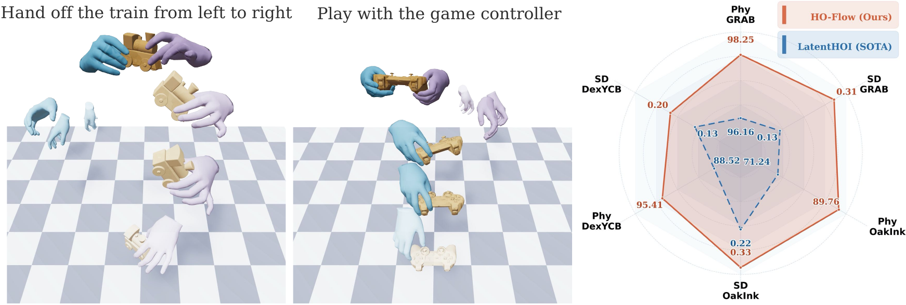

<div align="center">

# HO-Flow
### Generalizable Hand-Object Interaction Generation with Latent Flow Matching

[](https://zerchen.github.io/projects/hoflow.html)
[](https://zerchen.github.io/projects/hoflow.html)
[](https://arxiv.org/abs/2604.10836)

**[Zerui Chen](https://zerchen.github.io/)**<sup>1</sup>,
[Rolandos Alexandros Potamias](https://rolpotamias.github.io/)<sup>1</sup>,
[Shizhe Chen](https://cshizhe.github.io/)<sup>2</sup>,
[Jiankang Deng](https://jiankangdeng.github.io/)<sup>1</sup>,
[Cordelia Schmid](https://cordeliaschmid.github.io/)<sup>2</sup>,
[Stefanos Zafeiriou](https://wp.doc.ic.ac.uk/szafeiri/)<sup>1</sup>

<sup>1</sup>Imperial College London &nbsp;&nbsp; <sup>2</sup>Inria, CNRS, ENS-PSL

**ECCV 2026**



</div>

Official implementation of **HO-Flow**, which generates hand-object interactions from text and object geometry using an interaction-aware VAE and autoregressive flow matching.

## 🛠️ Environment Setup


```bash
conda create -n hoflow python=3.10 -y
conda activate hoflow
pip install torch==2.4.1 torchvision==0.19.1 torchaudio==2.4.1 \
  --index-url https://download.pytorch.org/whl/cu121
pip install -r requirements.txt
pip install scipy pandas git+https://github.com/zerchen/chumpy.git

cd common/networks/tgs/models/snowflake/pointnet2_ops_lib
python setup.py install
cd ../../../../../..
pip install --no-index torch-scatter -f https://data.pyg.org/whl/torch-2.4.1+cu121.html
wget https://anaconda.org/pytorch3d/pytorch3d/0.7.8/download/linux-64/pytorch3d-0.7.8-py310_cu121_pyt241.tar.bz2
conda install ./pytorch3d-0.7.8-py310_cu121_pyt241.tar.bz2
```

## 📦 Data Preparation

### GraspXL

Download [GraspXL](https://github.com/zdchan/GraspXL) to `datasets/graspxl/data/`.

```bash
python -m prep_data.graspxl --input_dir datasets/graspxl/data \
  --output_dir datasets/graspxl/data/full_seq_tars --group_seq
```

### GRAB

Download [GRAB](https://grab.is.tue.mpg.de/) to `datasets/grab/data/`.

```bash
python -m prep_data.grab --input_dir datasets/grab --output_dir datasets/grab/data --mode train
python -m prep_data.grab --input_dir datasets/grab --output_dir datasets/grab/data --mode test
```

### OakInk

Download aligned [OakInk](https://oakink.net/) meshes from [LatentHOI](https://github.com/jojo23333/LatetHOI#data-preparation) into `datasets/oakink/data/oakink_aligned/`.

```bash
python -m prep_data.oakink --input_dir datasets/oakink/data \
  --output_dir datasets/oakink/data/seq_tars
```

### DexYCB

Download [DexYCB](https://dex-ycb.github.io/) annotations and assets into `datasets/dexycb/data/`.

```bash
python -m prep_data.dexycb --input_dir datasets/dexycb/data --output_dir datasets/dexycb/data --mode train
python -m prep_data.dexycb --input_dir datasets/dexycb/data --output_dir datasets/dexycb/data --mode test
```

## 🚀 Training

### 1. Inter-VAE

```bash
cd tools
# GraspXL pretraining
bash dist_train.sh 4 6666 -e ../playground/inter_vae/experiments/graspxl.yaml --gpu 0-3 \
  train_batch_size 8 num_iters 100000

# GRAB fine-tuning
VAE_PRETRAIN_CKPT=/path/to/graspxl_vae_run/model_dump/snapshot_99999.pth.tar
bash dist_train.sh 4 6666 -e ../playground/inter_vae/experiments/grabs0.yaml --gpu 0-3 \
  ckpt "$VAE_PRETRAIN_CKPT" train_batch_size 8 num_iters 100000 lr 0.0001 end_lr 0.00001
```

### 2. Latent preparation

Use the same GRAB VAE for latent export and flow matching; `datasets/<dataset>/data/latent_tars/` must be empty.

```bash
VAE_CKPT=/path/to/grab_vae_run/model_dump/snapshot_99999.pth.tar
python precompute.py -e ../playground/inter_vae/experiments/graspxl.yaml \
  --ckpt "$VAE_CKPT" --gpu 0
python precompute.py -e ../playground/inter_vae/experiments/grabs0.yaml \
  --ckpt "$VAE_CKPT" --gpu 0
```

### 3. Autoregressive flow matching

```bash
# GraspXL pretraining
bash dist_train.sh 1 6666 -e ../playground/autoreg_flow/experiments/graspxl.yaml --gpu 0 \
  ae_ckpt "$VAE_CKPT" time_steps 18

# GRAB fine-tuning
AR_PRETRAIN_CKPT=/path/to/graspxl_generator_run/model_dump/snapshot_299999.pth.tar
bash dist_train.sh 1 6666 -e ../playground/autoreg_flow/experiments/grab_7k.yaml --gpu 0 \
  ckpt "$AR_PRETRAIN_CKPT" ae_ckpt "$VAE_CKPT" lr 0.0001 end_lr 0.00001 time_steps 18
```

DexYCB: fine-tune with each module's `dexycb.yaml`.

## 📊 Testing and Evaluation

From `tools/`, use each run's saved `exp.yaml`:

```bash
VAE_RUN=/path/to/outputs/inter_vae/your_grab_run
AR_RUN=/path/to/outputs/autoreg_flow/your_grab_run

# VAE reconstruction
bash dist_test.sh 1 6666 -e "$VAE_RUN/exp.yaml" --gpu 0 --test_epoch 99999
python eval_ae.py -e "$VAE_RUN/result_grab"

# GRAB generation
bash dist_test.sh 1 6666 -e "$AR_RUN/exp.yaml" --gpu 0 --test_epoch 299999 \
  ae_ckpt "$VAE_CKPT" time_steps 18
python eval_motion.py -e "$AR_RUN/result_grab" --num_proc 10

# OakInk generalization
bash dist_test.sh 1 6666 -e "$AR_RUN/exp.yaml" --gpu 0 --test_epoch 299999 \
  ae_ckpt "$VAE_CKPT" testset oakink testset_split s0_1k time_steps 18
python eval_motion.py -e "$AR_RUN/result_oakink" --num_proc 10
```

## 📝 Citation

```bibtex
@inproceedings{chen2026hoflow,
  author    = {Chen, Zerui and Potamias, Rolandos Alexandros and Chen, Shizhe and Deng, Jiankang and Schmid, Cordelia and Zafeiriou, Stefanos},
  title     = {{HO-Flow}: Generalizable Hand-Object Interaction Generation with Latent Flow Matching},
  booktitle = {ECCV},
  year      = {2026}
}
```

## 🙏 Acknowledgements

Thanks to [LatentHOI](https://github.com/jojo23333/LatetHOI) for code and data preparation, and to [GraspXL](https://github.com/zdchan/GraspXL), [GRAB](https://grab.is.tue.mpg.de/), [OakInk](https://oakink.net/), [DexYCB](https://dex-ycb.github.io/), and [MANO](https://mano.is.tue.mpg.de/).
